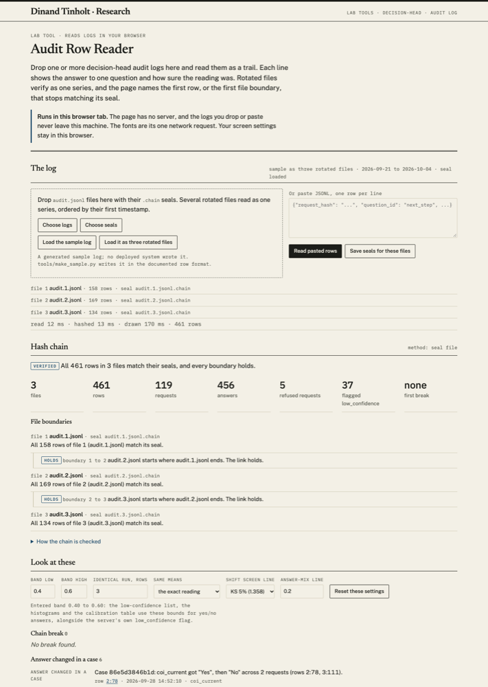

# Audit Row Reader

Public source: https://github.com/dtinholt/audit-row-reader (Apache-2.0, first public release 11 October 2026).

Part of the lab's work at https://dinand.com/research/. It reads the audit logs written by the decision head, https://github.com/dtinholt/decision-head.

A decision service you host yourself is only auditable if someone can read its trail and show that no row was changed or dropped. This page does both in the browser. It reads a decision-head audit log, verifies the seal file's hash chain across rotated files as one series, and charts calibration drift and answer mix beside a list of the rows worth a second look. Nothing is uploaded and the page has no server. The fonts are its one network request, and `localStorage` holds only the screen settings.



## Use it

Open `index.html` from a checkout, or go to https://dinand.com/experiments/audit-row-reader/. Drop one or more logs onto the page together with their `.chain` seals. Pasting rows works too.

To try it before you have a log of your own, load the files in `sample/`:

- `sample/sample-audit.jsonl` with `sample/sample-audit.jsonl.chain` is one log and its seal. The chain verifies.
- `sample/sample-audit-corrupted-row137.jsonl` is the same log with row 137 edited. Load it with the same seal and the page names row 137.
- `sample/series/` holds the same rows split into three rotated files, each with a seal. Drop all six files at once and the reader checks them as one series.
- `sample/series-missing-2/` is that series with the middle file removed. The break shows at the boundary.

"Load the sample log" and "Load it as three rotated files" do the same from buttons. `index.html?sample`, `index.html?series` and `index.html?seriesgap` do it on open.

## The chain format

A seal file holds one SHA-256 hash per row. The hash for row `i` covers the hash before it and the row's own line:

```
h[i] = sha256(h[i-1] + "\n" + line[i])
```

A first file starts from 64 zeros. A rotated file starts from the last hash of the file before it, and its seal records that on a `# start:` line. A `# file:` line names the log the seal belongs to. Change one row and its hash changes, and so does every hash after it. Cut rows from the end, or append rows after sealing, and the counts stop matching. Remove a whole file from a series and the next file's start hash points at a hash that is not there.

The reader also checks a second form, a `prev_hash` field on each row holding the SHA-256 of the previous line. An edit to row k shows at row k+1. An edit to the very last row cannot show, which is why the seal file is the stronger form. A log with neither gets a check that each line parses, and the page says that nothing is proven.

## What it does

- **Hash chain.** Verification names the first row that differs, rows cut from the end, and rows appended after the seal. A seal comes from this page or from `tools/seal.py`.
- **Several files as one series.** Drop rotated logs together. The reader orders them by first timestamp, pairs each seal with its log (by name, by its `# file:` line, or by the first hash), checks every file and every boundary, and names the first break as `file:row`. A missing, reordered or extended file breaks at its boundary. The same file loaded twice is read once and reported with its SHA-256. A lone seal that names a different file is not applied, and a seal with no readable hash lines (after normalising hex case and line endings) gives no verdict; the page says which.
- **Large logs.** Files stream in chunks with a progress bar and a Stop button. The trail table draws only the rows in view, with a go-to-row box (`345` or `2:15`). The drift chart plots at most about 1,200 windows. Read, hash and draw times show under the file list.
- **Look at these** lists rows worth a second look: chain breaks and broken boundaries, unreadable lines, probabilities outside 0 to 1, a request id reused at different times, a question answered differently inside one case, distribution shifts between the two halves of each question, runs of identical readings, and low-confidence rows (server flag or the entered band).
- **Cases.** Answered rows grouped by `request_hash`, with `-deliberate` set aside. Each case lists its requests in time order with the gap since the previous one and the questions answered, in log order. Refused requests hash without the model id, so they stay out.
- **Calibration by question.** For each yes/no question, one bin table per calibration document: rows, share of rows, mean P(yes), mean raw P(yes) from `raw_distribution.Yes`, share answered Yes, share flagged. A line per calibration change compares the two sides. The log holds no outcomes, so this is a distribution and cannot show whether the probabilities come true.
- **Charts** in inline SVG: calibration drift (rolling top probability against the rolling flagged share, with calibration changes marked), answer mix by day, and a probability histogram per question. Each has a "Show the numbers" table.
- **Saved screens.** Band bounds, run length, run key, the KS line and the answer-mix line persist in this browser, with a reset.
- **Redaction check and exports.** Before an export, the reader counts values holding an email address, a phone number, an IBAN that passes its checksum, or capitalised words that look like a name. It scans every text value and key, since finding 9 of the security review notes that free text in `question_id` or option names lands in the log. It keeps counts only. The flagged list exports as CSV. The whole trail exports as JSONL with only the fields you tick, and fields with matches start unticked. Either export stops behind a warning when matches would leave the page.
- **Keeping the seal.** A short guide on where the `.chain` file should live so the account that writes the log cannot rewrite it, quoting the security review.

### Definitions the page uses

- Probability: `answer.noul` (P(yes)) for yes/no questions; the top entry of `answer.probabilities` for choice and score. The drift chart's "top probability" is `max(p, 1 - p)` for yes/no.
- Band: "Band low" and "Band high" default to 0.4 and 0.6, the commented example in `decisionhead.example.toml`. The log does not record the bounds the server used, so every yes/no answer is re-screened against the entered bounds.
- Shift screen: two-sample Kolmogorov-Smirnov distance on the probability against `c * sqrt((n+m)/(n*m))`, with c the textbook 1.224, 1.358 or 1.628 for 10%, 5% or 1% (default 5%), plus the total-variation distance between the halves' answer mixes, flagged at 0.20 by default. The 0.20 is my choice. The halves are not independent samples and nothing corrects for screening several questions. It is a screen.
- Case: every answered row sharing a `request_hash` once a trailing `-deliberate` is removed. "Changed" means two or more different answer labels for one question inside a case, readings without a value left out.

## Tests

- `sh tests/smoke.sh` runs the Python tests under `-W error` and then the page self-check in headless Chrome, and exits non-zero on any failure. Point the `CHROME` environment variable at a Chrome binary: `CHROME="$(which google-chrome)" sh tests/smoke.sh`. `sh tests/smoke.sh --bench` adds a timed 100,000-row load. With node 22 or later it drives Chrome over the DevTools protocol on 127.0.0.1 through `tests/cdp.mjs`, so timings use a real clock; without node it falls back to `--dump-dom`.
- Page self-check: 51 core checks run on every open (console table and footer line). `index.html?selfcheck` adds 33 page checks that load logs into the page, 84 in all. They cover the chain rules, the streaming splitter, a 10x load through the file path, the virtual table, Stop, three-file series (intact, middle file missing, a row edited in file 3, rows appended to a closed file, a `prev_hash` series edited at a boundary, files given out of order, seals with unrelated names), the calibration table, cases, saved screens with full and blocked storage, the redaction patterns, both exports and the warning, script and img payloads, an empty log, and the fixes from two independent reviews.
- Python: `python3 tests/test_tools.py`, or `python3 -W error -m unittest discover -s tests`, 62 tests. They cover every function in `tools/seal.py` and its error paths, `rotate` and `verify-series` on real files, the sample and series files, the embedded sample against the files, and the stress fixtures.
- `tools/make_stress.py [outdir]` writes the hostile and oversized inputs. The small ones live in `tests/fixtures/`; the 10x, 100x, 100,000-row and 5 MB files go to `outdir`.

## Measured timings

Headless Chrome on the build laptop, real clock, sample rows repeated to size. These measure this page on one machine.

| Input | Rows | Size | Read | Hash | Draw | Total |
|---|---|---|---|---|---|---|
| sample, with seal | 461 | 0.4 MB | 12 ms | 10 ms | 165 ms | under 0.2 s |
| 100x sample, file | 46,100 | 40 MB | 497 ms | none | 136 ms | 0.64 s |
| 100x sample, file, with seal | 46,100 | 40 MB | 503 ms | 301 ms | 122 ms | 0.93 s |
| 100,000 rows, file, with seal | 100,000 | 86.5 MB | 968 ms | 590 ms | 322 ms | 1.9 s |
| 5 MB paste | 5,786 | 5 MB | 65 ms | none | 36 ms | 0.10 s |

The old page drew the 100x log in 363 ms in one blocking stretch, without a seal.

## Files

- `index.html`, `style.css`, `core.js` (logic, no DOM), `app.js` (page), `selfcheck.js`, `sample.js` (the embedded sample and its seal)
- `tools/seal.py`: `seal`, `verify`, `rotate`, `verify-series`, each with `--json`
- `tools/make_sample.py`: writes the sample, its seal, the corrupted copy, `sample.js`, `sample/series/` and `sample/series-missing-2/`
- `tools/make_stress.py`: stress inputs
- `sample/`: the synthetic log, its seals, the series and the broken series
- `tests/`: `test_tools.py`, `smoke.sh`, `cdp.mjs`, `fixtures/`
- `shots/series.png`: the page with a three-file series loaded
- `CHANGELOG.md`: what the stress round and the reviews found

### seal.py

```
python3 tools/seal.py seal audit.jsonl                    # first file, starts from zeros
python3 tools/seal.py seal audit.2.jsonl --after audit.1.jsonl.chain
python3 tools/seal.py rotate audit.jsonl --dir closed/    # copy to closed/audit.N.jsonl, seal it linked to N-1, truncate
python3 tools/seal.py verify-series closed/audit.1.jsonl closed/audit.2.jsonl --json
```

`rotate` is copy-truncate, which `docs/audit-log.md` calls safe because each write opens the file in append mode. Rows appended during the copy are carried over before the truncate. A row written between the last size check and the truncate can still be lost, as with any copy-truncate rotation.

## The sample

A generated sample log; no deployed system wrote it. It holds 119 requests in 461 rows from 2026-09-21 to 2026-10-04, using the questions in `examples/supplier_onboarding_questions.json`, backend `FakeBackend` and model `sample-model`. The story built in: the calibration document changes on 2026-09-28; `coi_current` drifts into the band; `next_step` moves from APPROVE towards REQUEST_DOCS; the backend repeats one `next_step` reading five times; three earlier cases are sent again after the calibration change and come back with different answers; cache hits, two degraded readings, five refused requests and some deliberate rows fill out the rest. `sample/series/` splits it at 2026-09-26 and 2026-10-01 into 158, 169 and 134 rows.

## Limits

- The decision head service does not yet write the chain file itself. Its `docs/audit-log.md` says rows are not chained or signed, and chained row hashes sit on its planned list. Today you make the seal with `tools/seal.py` or this page, after the rows are written. A log without a seal or a `prev_hash` field cannot be proven unchanged.
- What the service would need to write, for the decision-head backlog: `prev_hash` on every row, in a point release, with the chain resetting per file and the first row of a file carrying the previous file's final hash (the reader already verifies that form across files); a per-row backend digest, so a row names the exact backend build or model file it came from; and, proposed here and not yet decided, the abstain band bounds on each flagged row.
- It does not recompute `request_hash` or calibrated probabilities. That needs the case records and the calibration file (`docs/audit-log.md`, "Reconstructing a decision").
- The calibration view has no outcomes to compare against, so it shows spread only.
- The redaction check is pattern matching. It misses names in lower case or single words and flags product names; a zero count is no guarantee.
- It holds every line in memory. 100,000 rows (86 MB) load in about two seconds here; logs of several hundred MB will strain a browser tab.
- Rows split by a bare carriage return read as one line, to match `seal.py`; the page counts them.
- Printing draws up to 2,000 trail rows.

## Licence

Apache-2.0. See `LICENSE`.

## Sources

decision-head repository: `docs/audit-log.md`, `docs/http-api.md`, `docs/configuration.md`, `docs/calibration.md`, `decisionhead.example.toml`, `README.md` (Planned), `docs/security-review-2026-10-06.md` (threat model A4 and TB4, findings 8 and 9), `docs/security-review-2026-10-06-closures.md` (prev_hash deferred pending rotation), `examples/supplier_onboarding_questions.json`. KS coefficients: the standard two-sample table.
